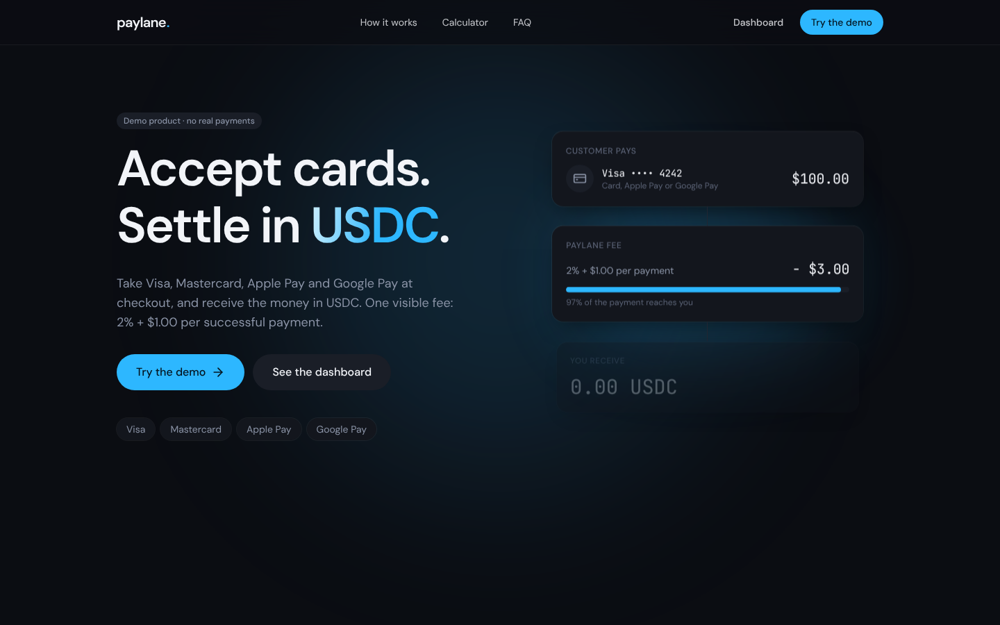
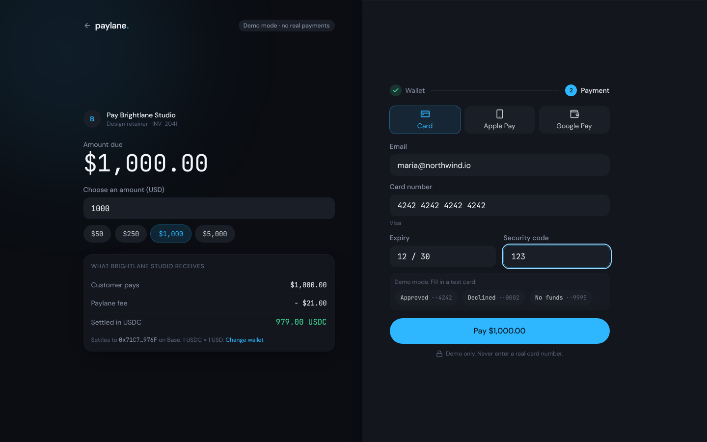
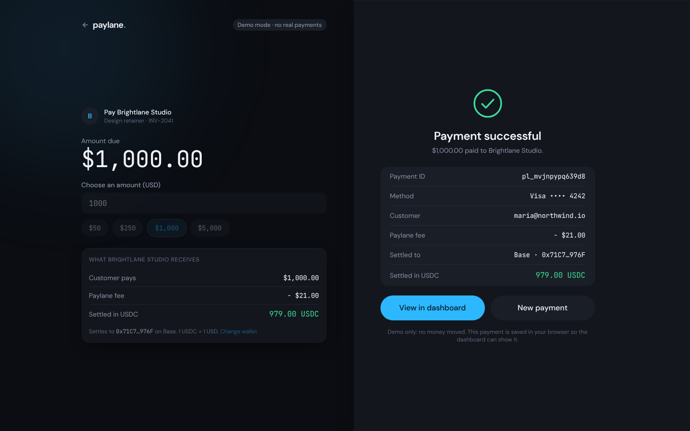
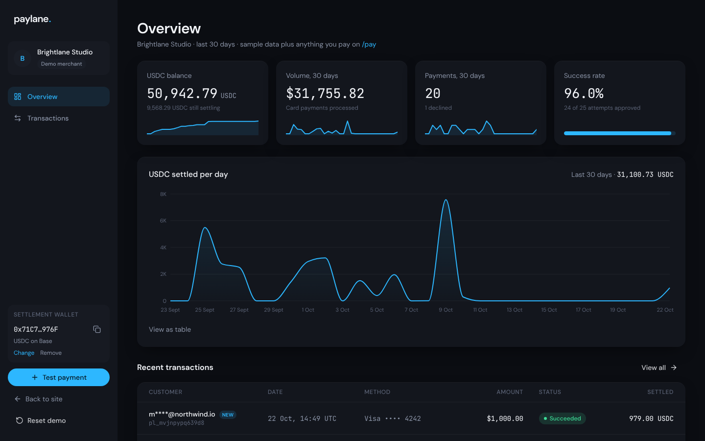
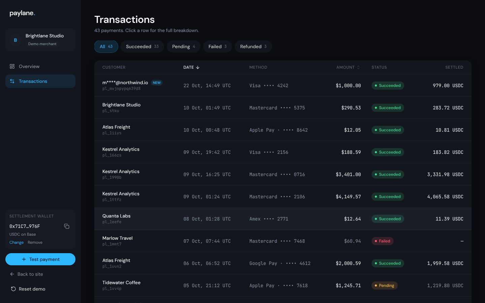

# Paylane

**Accept cards. Settle in USDC.**

Paylane is a demo payment gateway: a marketing site, a checkout flow and a merchant dashboard in one Next.js app. A customer pays by card, the merchant is settled in USDC on Base, Ethereum or Solana. **No real payments are made.**

**Live demo:** coming soon



| Checkout | Receipt |
| --- | --- |
|  |  |

| Dashboard | Transactions |
| --- | --- |
|  |  |

## Try it

Open `/pay`, pick the settlement wallet (type an address, connect a real wallet, or use the demo wallet), then pay with a test card:

| Card number | Result |
| --- | --- |
| `4242 4242 4242 4242` | Succeeds |
| `4000 0000 0000 0002` | Declined by issuer |
| `4000 0000 0000 9995` | Insufficient funds |

Use any future expiry date and any CVC (4 digits for Amex-style numbers). Apple Pay and Google Pay always succeed in the demo. Then open `/dashboard` to see the payment arrive.

## What is inside

- **Landing page** with a fee calculator, an explanation of the card-to-USDC flow, a FAQ, and structured data for search engines.
- **Checkout** (`/pay`): settlement wallet step, card validation (Luhn, expiry, CVC, brand detection), network-aware wallet validation (EVM `0x` + 40 hex characters, Solana base58 decoding to exactly 32 bytes), clear decline states.
- **Merchant dashboard** (`/dashboard`): USDC balance, volume, success rate, a daily settlement chart, a searchable and sortable transaction table with a detail drawer.
- **Shared backend**: every payment is saved in a database and appears for every visitor, with your own payments tagged "New". "Reset demo" removes only your payments.
- **Accessibility and polish**: keyboard navigation, skip link, visible focus, reduced-motion support, responsive from phone to desktop, branded 404 and error pages, share image, sitemap and robots rules.

## Tech stack

| Area | Choice |
| --- | --- |
| Framework | Next.js 16 (App Router, Turbopack, Cache Components), React 19 |
| Language | TypeScript |
| Styling | Tailwind CSS 4, DM Sans and JetBrains Mono |
| Motion and charts | Framer Motion, Recharts |
| Validation | Zod 4 (one schema is shared by the browser form and the API) |
| Wallet connection | Reown AppKit (WalletConnect) with wagmi and Solana adapters |
| Database | libSQL: a local SQLite file in development and Docker, Turso in production |
| Tests | Vitest |
| CI | GitHub Actions: lint, type check, tests, build |
| Deployment | Vercel and Turso, or Docker |

## Run it locally

Requirements: Node.js 22.13 or newer.

```bash
npm ci
npm run dev
```

Open http://localhost:3000. Use `localhost` rather than a LAN address: Next blocks its dev scripts on other hosts, and browsers only provide some crypto functions on secure origins.

Optional: copy `.env.example` to `.env.local` to enable the real **Connect wallet** button (free Reown project ID, add `http://localhost:3000` to its allowed domains). Without it the button is hidden and everything else works.

| Command | What it does |
| --- | --- |
| `npm run dev` | Development server |
| `npm run dev:clean` | Same, after clearing the `.next` cache |
| `npm run lint` | ESLint |
| `npm run typecheck` | Generates route types, then runs `tsc` |
| `npm test` | Unit tests |
| `npm run build` | Production build |

## Environment variables

| Variable | Needed | Purpose |
| --- | --- | --- |
| `NEXT_PUBLIC_REOWN_PROJECT_ID` | Optional | Turns on the real wallet connection |
| `NEXT_PUBLIC_SITE_URL` | Optional | Public address used in share links, sitemap and canonical URLs. On Vercel it is detected automatically |
| `TURSO_DATABASE_URL`, `TURSO_AUTH_TOKEN` | Production | Turso database. When set, they win over `DATABASE_PATH` |
| `DATABASE_PATH` | Optional | SQLite file for local and Docker use (default `./data/paylane.db`) |

`NEXT_PUBLIC_*` values are read at build time.

## Deploy

### Vercel and Turso (free)

1. Install the Turso CLI and create a database:
   ```bash
   turso db create paylane
   turso db show paylane --url        # libsql://paylane-<you>.turso.io
   turso db tokens create paylane     # the auth token
   ```
2. Push the repository to GitHub and import it in Vercel.
3. In the Vercel project settings add `TURSO_DATABASE_URL`, `TURSO_AUTH_TOKEN` and, optionally, `NEXT_PUBLIC_REOWN_PROJECT_ID`. Add the Vercel domain to the Reown project's allowed domains.
4. Deploy. The table is created on first use. `GET /api/health` should answer `{"ok":true}`.

### Docker

```bash
docker compose up --build
```

The app listens on http://localhost:3000. The database lives in the `paylane-data` volume, so payments survive `docker compose down` and `up`. To enable the wallet button, put `NEXT_PUBLIC_REOWN_PROJECT_ID` in a `.env` file next to `docker-compose.yml` before building.

## How it works

### Money

All amounts are integers. There are no floating-point amounts anywhere in the payment path. The fee is `2% + $1`, USDC is 1:1 with USD, and the same function (`calculateSettlement`) produces the numbers for the calculator, the checkout summary, the API and the dashboard.

### API

| Route | Method | Purpose |
| --- | --- | --- |
| `/api/checkout` | POST | Validates the request, simulates the card result, saves the attempt, returns the settlement |
| `/api/orders` | GET, DELETE | Lists shared payments (`mine` flag per visitor); removes only the caller's payments |
| `/api/transactions` | GET | Sample data plus saved payments, with `status`, `q`, `sort`, `order` filters |
| `/api/rates` | GET | Fee and USDC amount for a given amount |
| `/api/health` | GET | Liveness and database check |

### Data and privacy

The database is shared by all visitors, so what is stored is limited on purpose:

- **Card numbers are never stored.** Only the brand and the last four digits.
- **Emails and wallets are masked before saving** (`m****@northwind.io`, `0x71C7…976F`). The payer gets the full wallet back in their own receipt only.
- **Ownership without accounts:** the browser makes a random token and sends it with each payment; the server keeps only its SHA-256 hash. That is how "New" tags and "Reset demo" know which payments are yours.
- **Rate limiting:** 20 payment attempts per minute per address, and a lower cap on list and delete requests. The limiter is in memory, so on serverless hosting it applies per instance.
- **Retention:** only the newest 300 payments are kept.
- **Headers:** `X-Content-Type-Options`, `X-Frame-Options`, `Referrer-Policy`, `Permissions-Policy`, HSTS, and a `Content-Security-Policy` in report-only mode (production builds).

### Project structure

```
src/
  app/                  routes: /, /pay, /dashboard, /api/*, share image, sitemap, robots
  components/
    landing/            marketing sections
    checkout/           wallet step, card form, receipt
    dashboard/          KPI cards, chart, transactions table, drawer
    ui/                 buttons, inputs, badges, cards (the design system)
  lib/
    fees.ts             settlement maths (integers only)
    card.ts             Luhn, brand detection, expiry and CVC rules
    wallet.ts           per-network address validation
    types.ts            Zod schemas shared by the browser and the API
    server/             database, payments repository, rate limiter (server only)
docs/screenshots/       images used in this README
```

## Tests

```bash
npm test
```

Unit tests cover the fee and settlement maths, card and wallet validation, formatting, dashboard analytics, privacy masking, the rate limiter and the payments repository (in-memory libSQL).

## Known advisories

`npm audit` reports 11 advisories (7 moderate, 4 high). All of them come from one chain: the Solana wallet libraries that Reown AppKit pulls in (`@solana/web3.js` → `jayson` → `stream-json`, `uuid`, and `bigint-buffer`). There is no fixed release to move to: the only "fix" npm offers is `npm audit fix --force`, which downgrades the Solana adapter to an older major version.

Why this is acceptable for a demo, and what I did instead:

- The vulnerable code is not on the payment path. It is only loaded in the browser when someone connects a Solana wallet, and it never parses untrusted data from the server.
- The server-side dependencies (Next.js, the database driver) have no open advisories. An earlier critical Next.js advisory was fixed by updating to 16.4.3.
- Solana support is kept on purpose, and the libraries will be updated as soon as fixes are published. CI runs on the pinned lockfile, so an update is a deliberate, reviewed change.

## Disclaimer

Paylane is a portfolio project. It is not affiliated with any payment company, processes no real payments and must not be used with real card details.
